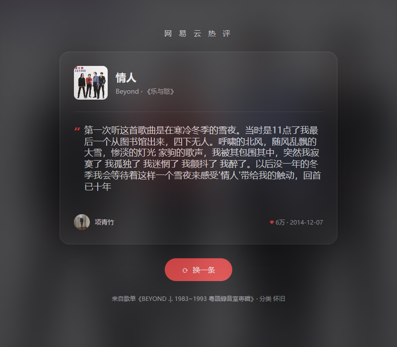

# 网易云随机热评

[](https://github.com/ZypherChan/MusicComments/actions/workflows/release.yml)
[](https://go.dev/)
[](https://github.com/egoist/mygo/tree/v0.5.5)


一个轻量的 Windows 桌面应用。打开窗口，从网易云音乐的热门歌单中随机选一首歌，读一条评论；点击「换一条」，继续遇见下一首歌的故事。

基于 **Go + MyGo 原生 UI** 开发，由 MyGo 在 Windows 上通过 Direct3D 11 绘制界面。无需 WebView2、浏览器、Node.js 或单独部署后端服务。



*真实 Windows 原生窗口截图：BEYOND《情人》，热评 59,776 赞；每次随机结果不同。*

<details>
<summary>窄窗口预览</summary>


</details>

## 功能

- 优先抽取怀旧和经典老歌歌单，同时保留华语、欧美、摇滚等分类的随机探索。
- 优先展示 1000 赞及以上的热评，并保留较高赞评论兜底。
- 展示歌曲封面、歌手、专辑、评论者、点赞数及来源歌单。
- 支持 60 种网易云评论表情，图片随程序嵌入；未知表情标记保留原文。
- 深色卡片与封面背景，支持调整窗口大小、长评论滚动、文本选择与复制。
- 网络请求在后台执行，加载时显示抽取进度；失败后可重新抽取，图片加载失败时使用占位图。

本项目用于浏览评论，不提供歌曲播放或下载功能。

### 抽取策略

每轮有 50% 的概率选择“怀旧”分类，其余从另外 23 个分类中随机选择。若返回的歌单中有名称包含“经典、老歌、金曲、怀旧、年代”等词的歌单，会以 50% 的概率优先从这些歌单中选择。这是通过分类和名称提高老歌概率，不按发行年份硬性筛选。

每次刷新最多尝试 5 个歌单，每个歌单最多抽取 6 首不同歌曲。从第一轮起，找到点赞数不少于 1000 的评论即可返回；优先在符合门槛的热评中随机选择，没有时再检查最新评论。不再单独优先万赞评论，也不会固定选择点赞最高的一条。

搜索总时限为 30 秒。若没有找到符合门槛的评论，会使用搜索期间已找到的较高赞评论；如果完全没有可用评论，才提示重试。因此兜底时仍可能展示不足 1000 赞的评论。

## 使用

目前已在 **Windows x64** 上验证。

如果仓库的 **Releases** 提供了构建产物，可下载安装包，或下载独立的 `MusicComments.exe` 直接运行。运行成品无需安装 Go、Node.js 或 WebView2。

打开应用后自动抽取第一条评论，点击「换一条」即可继续。长评论可在评论区域内滚动查看。应用直接请求网易云音乐接口，需要网络连接；若出现「这次没抽到」提示，可以稍后重试。

## 本地开发与编译

### 环境要求

- Windows x64（当前验证平台）。
- Go 1.27.1 或更高版本，以 `go.mod` 为准。
- 首次构建时需能下载 Go 模块依赖。

项目将 MyGo CLI 声明为 Go 工具依赖，不需要全局安装 CLI，也不需要 npm 或前端构建工具。

### 启动开发模式

克隆或下载仓库后，在项目根目录打开 PowerShell：

```powershell
go mod download
go tool mygo dev
```

开发模式支持 Go 代码变更后重新编译。也可以直接运行：

```powershell
go run .
```

### 编译发布版本

```powershell
go tool mygo build
```

该命令编译 Go 程序并生成 Windows 安装包，默认产物位于：

```text
build/windows-amd64/
├── MusicComments.exe
└── MusicComments Setup 1.0.1 amd64.exe
```

应用名称、版本号及输出目录在 `mygo.json` 中配置，安装包名称随版本变化。

如只需要编译一个可执行文件：

```powershell
go build -ldflags="-H windowsgui" -o build/MusicComments.exe .
```

### 常用命令

| 命令 | 作用 |
| --- | --- |
| `go tool mygo dev` | 启动桌面开发模式 |
| `go tool mygo build` | 构建桌面程序与安装包 |
| `go test ./...` | 运行请求逻辑及原生界面测试 |
| `go vet ./...` | Go 静态检查 |
| `go tool mygo vet` | 检查原生 UI 构建对象的生命周期 |

## 技术栈与目录

| 层次 | 技术 | 职责 |
| --- | --- | --- |
| 桌面与界面 | [MyGo 0.5.5](https://github.com/egoist/mygo/tree/v0.5.5) / `ui` | 原生窗口、布局、组件、图片及 GPU 绘制 |
| 评论排版 | MyGo `ui/richtext` | 只读富文本、内嵌表情、选择复制及长评论滚动 |
| 数据请求 | Go / 标准库 `net/http` | 歌单与歌曲抽取、评论获取、超时与重试 |
| 构建打包 | Go / MyGo CLI | 编译可执行文件与生成安装包 |
| 测试 | Go testing / MyGo `ui.NewTester` | 接口逻辑、原生交互与布局验证 |

```text
.
├── main.go                  # 原生窗口入口
├── desktop.go               # 评论卡片、异步请求、图片加载与状态管理
├── comment.go               # 本地表情与原生富文本转换
├── internal/music/          # 网易云请求、随机抽取及单元测试
├── assets/
│   ├── emoji-map.json       # 表情名称与图片 ID 映射
│   └── emoji/              # 嵌入可执行文件的表情图片
├── resources/icon.png       # 应用与安装包图标
├── docs/images/             # README 截图
├── desktop_test.go          # 原生界面、表情、图片及交互测试
├── native_test.go           # 可选的真实窗口与实时接口检查
└── mygo.json                # 应用与打包配置
```

## 测试

```powershell
go test ./...
go vet ./...
go tool mygo vet
```

默认测试使用本地 HTTP 服务及内存中的原生界面，不依赖浏览器、WebView2 或网易云实时接口。覆盖请求重试、加载与进度、失败恢复、关闭时取消请求、旧图片结果隔离、表情、只读评论，以及 800px / 390px / 360px 布局。

若要检查真实原生窗口和网易云接口，可运行以下命令。它会打开临时桌面窗口，检查后自动退出，需要网络连接：

```powershell
$env:MUSIC_NATIVE_TEST = '1'
try {
    go test -count=1 -v .
} finally {
    Remove-Item Env:MUSIC_NATIVE_TEST
}
```

成功时会保存 `test-results/native-live.png` 和 `test-results/native-narrow.png`。测试输出及构建产物已在 `.gitignore` 中排除。

## 接口与素材说明

本项目是非官方应用，与网易云音乐无隶属关系。当前直接访问 `http://music.163.com` 的网页接口，无需配置账号或第三方代理；接口可用性取决于网络和上游服务，接口变化可能导致抽取失败。

歌曲封面、评论、用户头像及其他网易云内容属于其各自权利人。仓库内素材来源（获取日期：2026-10-21）：

- 应用图标：网易云音乐官方 App Store 页面，通过 [Apple Lookup API](https://itunes.apple.com/lookup?id=590338362&country=cn) 获取。
- 表情映射：网易云音乐[官方网页客户端脚本](https://s3.music.126.net/web/s/core_c7686f506f6f2607bb7f6cea1951f039.js)。
- 表情图片：网易云音乐官方 CDN，地址格式为 `https://s1.music.126.net/style/web2/emt/emoji_{ID}.png`，已保存在 `assets/emoji/` 中。

上述素材的权利归原权利人所有。
